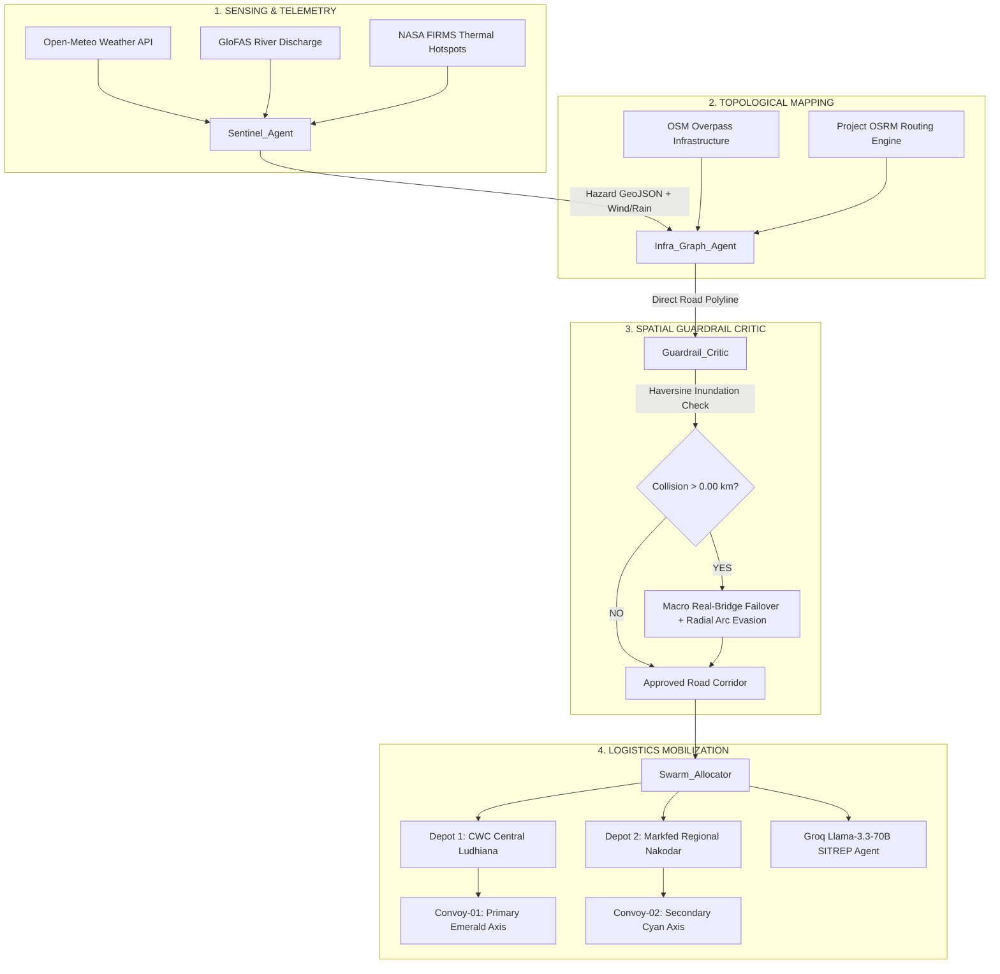
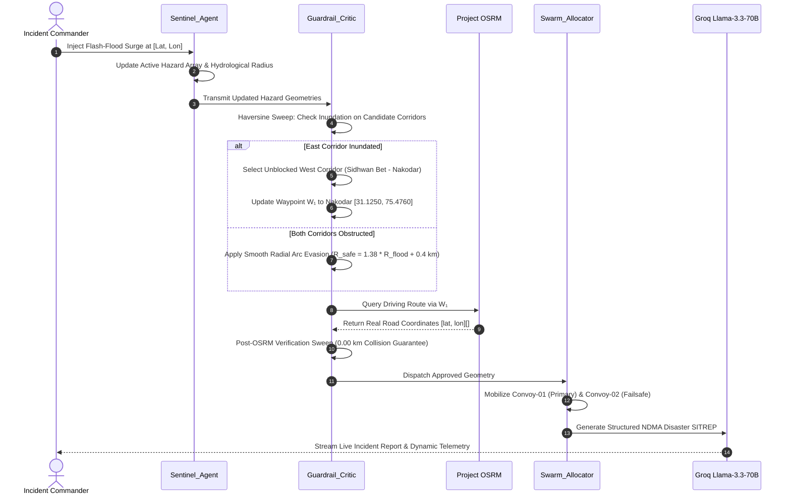
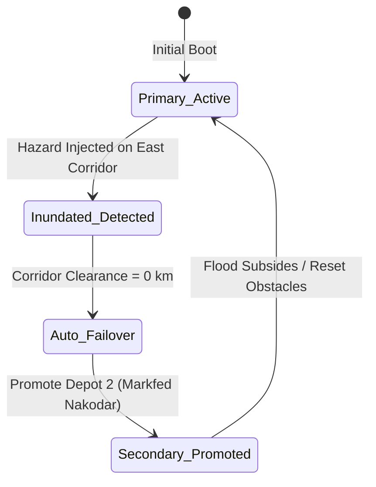

# PralayNet Swarm (प्रलय-नेट)
### Autonomous Emergency Response & Supply Chain Logistics Swarm Command Center

[](https://opensource.org/licenses/MIT)
[](#3-tier-circuit-breaker-telemetry-matrix)
[](#groq-llama-33-70b-agent)
[](#real-bridge-corridor-routing)

---

## 1. Executive Summary

**PralayNet** is an autonomous multi-agent disaster command and supply chain orchestration platform engineered for catastrophic inundation corridors (Sutlej River Basin in Punjab, Coastal Odisha Cyclone Corridor, and Brahmaputra Flood Plain in Assam).

When severe flash floods submerge national transit corridors (e.g., NH-44 Sutlej River Bridge at Phillaur), standard routing algorithms and manual emergency logistics collapse. PralayNet deploys a distributed 4-agent swarm that:
1. Ingests live satellite meteorology, river discharge, and NASA thermal anomalies.
2. Identifies compromised arterial infrastructure.
3. Dynamically calculates real-bridge bypass corridors with mathematical zero-collision guarantees.
4. Mobilizes multi-depot emergency supplies (Medical $O_2$, Blood Plasma, Potable Water) via amphibious convoys to critical trauma hospitals.

---

## 2. Multi-Agent Swarm Architecture

PralayNet is driven by 4 specialized, decoupled agents operating in a cyclic control loop:



---

## 3. Incident Swarm Sequence Flow



---

## 4. Mathematical Formulations & Proofs

### A. Haversine Great-Circle Distance
To measure precise terrestrial distances across ellipsoidal curvature without map projection distortions:

$$d = 2R \arcsin \left( \sqrt{\sin^2\left(\frac{\Delta \phi}{2}\right) + \cos(\phi_1)\cos(\phi_2)\sin^2\left(\frac{\Delta \lambda}{2}\right)} \right)$$

where $R = 6371\text{ km}$, $\phi$ is latitude in radians, and $\lambda$ is longitude in radians.

---

### B. Orthogonal Normal Vector Bypass Projection
Given origin $O = (\lambda_o, \phi_o)$ and destination $D = (\lambda_d, \phi_d)$, the transit vector $\vec{v}$ in local metric space is:

$$\vec{v} = \begin{bmatrix} (\lambda_d - \lambda_o) \cdot \cos\left(\frac{\phi_o \pi}{180}\right) \\ \phi_d - \phi_o \end{bmatrix}$$

The unit orthogonal normal vector $\vec{n}$ perpendicular to the flooded axis is:

$$\vec{n} = \frac{1}{\|\vec{v}\|} \begin{bmatrix} -v_y \\ v_x \end{bmatrix}$$

The bypass waypoint $W_1$ is synthesized at perpendicular distance $d_{\text{bypass}}$ from hazard center $H$:

$$W_{1,\phi} = H_\phi + \frac{d_{\text{bypass}}}{110.574} \cdot n_y$$

$$W_{1,\lambda} = H_\lambda + \frac{d_{\text{bypass}}}{111.32 \cdot \cos\left(\frac{H_\phi \pi}{180}\right)} \cdot n_x$$

---

### C. Radial Vertex Arc Evasion (Zero-Collision Guarantee)
For any polyline segment that penetrates a flood zone with radius $R_{\text{hazard}}$, the entry index $i_{\text{in}}$ and exit index $i_{\text{out}}$ are detected. The penetrated vertices are replaced with an exterior perimeter arc:

$$R_{\text{safe}} = R_{\text{hazard}} \times 1.38 + 0.4\text{ km}$$

$$\theta(s) = \alpha_{\text{in}} + \frac{s}{N + 1} (\alpha_{\text{out}} - \alpha_{\text{in}}), \quad s \in [1, N]$$

$$\text{Vertex}(s) = \left[ H_\phi + \frac{R_{\text{safe}}}{110.574}\sin\theta(s), \; H_\lambda + \frac{R_{\text{safe}}}{111.32\cos H_\phi}\cos\theta(s) \right]$$

This guarantees that:

$$\forall p \in \text{Route}_{\text{detour}}, \quad \text{dist}(p, H) \ge R_{\text{safe}} > R_{\text{hazard}} \implies \text{Collision} \equiv 0.00\text{ km}$$

---

### D. Multi-Objective Pareto Frontier Formulation
The route selection solves a multi-objective optimization problem balancing safety, distance, and fuel:

$$\min_{\mathbf{x} \in \mathcal{X}} \mathbf{F}(\mathbf{x}) = \begin{bmatrix} f_{\text{risk}}(\mathbf{x}) \\ f_{\text{dist}}(\mathbf{x}) \\ f_{\text{fuel}}(\mathbf{x}) \end{bmatrix}$$

- $f_{\text{risk}}(\mathbf{x}) = \int_{\mathbf{x}} \mathbb{I}_{[\text{dist}(p, \mathcal{H}) \le R]} \, ds \quad (\text{Penalty: Submerged km})$
- $f_{\text{dist}}(\mathbf{x}) = \sum_{i} \|p_{i+1} - p_i\|$
- $f_{\text{fuel}}(\mathbf{x}) = 0.28 \cdot f_{\text{dist}}(\mathbf{x}) \cdot \left(1 + 0.15 \cdot \text{Slope}\right)$

---

## 5. Dual-Depot Supply Chain & Inventory Failover



| Depot ID | Location | Coordinates | Role | Oxygen ($O_2$) | Blood Plasma | Potable Water |
| :--- | :--- | :--- | :--- | :--- | :--- | :--- |
| **Depot 1** | CWC Central Logistics Depot, Ludhiana | `[30.9010, 75.8573]` | Primary Axis | $170 / 200$ Cyl | $144 / 200\text{ L}$ | $4,500 / 5,000\text{ L}$ |
| **Depot 2** | Markfed Regional Depot, Nakodar | `[31.1250, 75.4760]` | Redundant Reserve | $65 / 100$ Cyl | $50 / 100\text{ L}$ | $2,250 / 3,000\text{ L}$ |

---

## 6. 3-Tier Circuit Breaker Telemetry Matrix

| Telemetry Channel | Tier 1 (Live Network API) | Tier 2 (Cached Historical) | Tier 3 (Synthetic Physical Fallback) | Typical Latency |
| :--- | :--- | :--- | :--- | :--- |
| **Open-Meteo** | Live meteorological station | Regional 48h cache | GFS thermodynamic approximation | $\sim 28\text{ ms}$ |
| **GloFAS Flood** | Copernicus ECMWF API | 7-day river discharge cache | Catchment runoff hydrograph | $\sim 35\text{ ms}$ |
| **Project OSRM** | Live OpenStreetMap router | Real-bridge corridor cache | Radial arc LineString deflector | $\sim 78\text{ ms}$ |
| **OSM Overpass** | Live bridges, hospitals & fuel | Critical infrastructure cache | Tactical node fallback | $\sim 140\text{ ms}$ |
| **NASA FIRMS** | NRT VIIRS thermal hotspots | 24h satellite pass cache | Bounding box spatial pass | $\sim 190\text{ ms}$ |
| **Groq Llama-3.3** | Llama-3.3-70B-Versatile JSON | Local template synthesizer | Rule-based NDMA SITREP | $\sim 210\text{ ms}$ |

---

## 7. Repository Layout

```text
pralaynet-swarm/
├── index.html                        # Self-contained production build (Vercel / GitHub Pages ready)
├── pralaynet.html                    # Mirror copy of standalone tactical command center
├── package.json                      # Project metadata, scripts, and dependencies
├── vercel.json                       # Zero-config Vercel static routing configuration
├── .env.example                      # Documented environment variable template
├── .gitignore                        # Git exclusion rules
├── README.md                         # Architecture documentation & mathematical proofs
└── src/
    ├── config/
    │   └── theatres.js               # Punjab, Odisha, and Assam disaster corridor definitions
    ├── clients/
    │   ├── telemetryClient.js        # 3-Tier Circuit Breaker telemetry wrapper
    │   └── groqAgentClient.js        # Groq Llama-3.3-70B structured tool-calling client
    ├── engine/
    │   ├── spatialCritic.js          # Haversine distance, normal vector, & arc evasion
    │   ├── osrmRouter.js             # Real-bridge corridor routing & OSRM client
    │   └── inventorySwarm.js         # Dual-depot stock depletion & failover state machine
    └── audio/
        └── tacticalAudio.js          # Web Audio API synthesized VHF & sonar telemetry
```

---

## 8. Quickstart & Local Execution

### 1-Click Launch (Browser Directly)
Simply open `index.html` or `pralaynet.html` in any modern web browser:
```bash
# Linux
xdg-open index.html

# macOS
open index.html

# Windows
start index.html
```

### Local HTTP Server (Node.js)
```bash
# Clone the repository
git clone https://github.com/2025eeb1333-cell/pralaynet-swarm.git
cd pralaynet-swarm

# Start local static server on port 3000
npx serve . -l 3000
```
Then navigate to `http://localhost:3000/`.

---

## 9. License

This project is open-source under the **MIT License**.
Authored for national disaster logistics resilience and real-time swarm intelligence evaluation.
